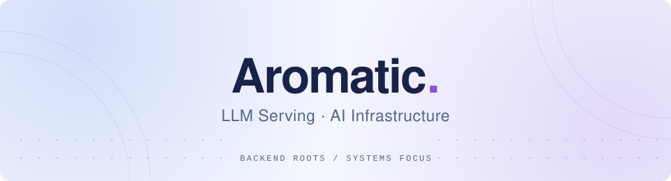

<picture>
  <source media="(max-width: 600px) and (prefers-color-scheme: dark)" srcset="assets/header-a-mobile-dark.svg">
  <source media="(max-width: 600px) and (prefers-color-scheme: light)" srcset="assets/header-a-mobile.svg">
  <source media="(prefers-color-scheme: dark)" srcset="assets/header-a-dark.svg">
  
</picture>

 

Software Engineering undergraduate at <b>UESTC</b>, with a background in backend development. 
Currently extending <b>SGLang</b> for LLM inference.

<b>Tencent WXG</b> · Backend Development Intern

<a href="https://wrygill.github.io/"><picture><source media="(prefers-color-scheme: dark)" srcset="assets/blog-dark.svg"></picture></a>
<a href="mailto:constantblock37@gmail.com"><picture><source media="(prefers-color-scheme: dark)" srcset="assets/email-dark.svg"></picture></a>

WeChat · <code>constantblock37</code>

